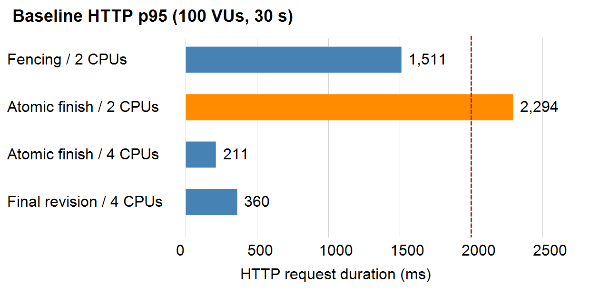

**Abstract—** SayangCare is a stateful voice-support prototype combining Rust/Actix Web, Redis Sentinel, PostgreSQL, distress-aware circuit breaking and volunteer escalation. Versioned PostgreSQL checkpoints preserve acknowledged session state while Redis supplies disposable hot projections and risk/FIFO queue ordering. Optional three-voter OpenRaft coordinates ownership generations; PostgreSQL rejects stale-owner mutations. The revised workspace passed 113 tests, with seven environment-dependent tests excluded and relevant database integrations executed separately. On single-node Minikube, a 100-user baseline completed 2,100 lifecycles without HTTP failures; an API-pod-loss experiment completed 4,410. Automatic Redis promotion preserved all 2,208 acknowledged lifecycles without HTTP failures. PostgreSQL replacement preserved every acknowledged operation but caused 0.609% HTTP failures during an 18.662-second recovery, failing strict availability acceptance. Atomic terminal persistence, additional actual CPU capacity and corrected upstream keep-alive addressed measured performance bottlenecks without relaxing durability or test gates. The professor-approved demonstration uses the dashboard; real speech, audio delivery and outbound ringing remain unvalidated. Results establish bounded local prototype behaviour, not production availability or clinical safety.

**Keywords—** distributed systems, voice interface, session recovery, circuit breaker, Raft, telehealth triage

::: {.twocol}

## 1. Introduction and Motivation

Access to digital support is not equally convenient for everyone. A telephone call does not require a user to install an application, navigate a touchscreen, or own a modern smartphone. Voice interfaces and social robots have consequently been investigated as ways to support older adults and people experiencing isolation [7], [8]. That evidence concerns user engagement and wellbeing outcomes; it does not establish that an AI system can provide clinical care. SayangCare therefore treats its conversational component as a prototype for supportive listening and deterministic risk triage, not diagnosis, treatment, or an emergency service.

Telephone access changes the engineering problem. A call may span multiple webhook requests, be processed by different API instances, and depend on a third-party speech and telephony provider and an external inference API. Losing one process must not erase the conversation state, and a slow inference dependency must not hold every caller indefinitely. A conventional stateless request/response service does not by itself solve either issue. Callers at elevated risk also need a path to a human operator rather than an unbounded conversation with a model.

The submitted proposal set out two linked ideas: preserve context across service failures and adapt circuit-breaker behaviour to distress. The implementation develops these using versioned durable checkpoints, a Redis hot projection, an inactivity sweeper, cached-audio degradation, and auditable volunteer assignments. Failure testing motivated a change from Redis-first acknowledgment to PostgreSQL-backed commit authority. The project also integrates Twilio webhooks and provides Docker and Kubernetes deployment artefacts.

The contribution is an application-specific integration, not a new consensus protocol or validated clinical triage algorithm. The design connects caller state, inference degradation, and human escalation. Synthetic fault tests measure committed-state preservation and bounded fallback; they do not establish real-call safety or human outcomes.

## 2. Related Work

The circuit-breaker pattern isolates a failing dependency by stopping calls after observed failures and allowing a controlled recovery probe [1], [2]. This limits cascading failure and wasted work, but a conventional breaker treats requests according to service health rather than the consequence of failure to a particular user. SayangCare retains the familiar Closed, Open, and Half-Open states, while its adaptive policy lowers error-rate and latency limits as the caller's distress signal increases. The intended effect is to choose a conservative fallback sooner for a caller who may need timely human support. Unlike general-purpose resilience libraries, the policy is connected to a caller/session risk signal; unlike a generic audio fallback, it is designed to preserve the conversation and create an escalation path. Its heuristic signal and thresholds are prototype choices and require validation before operational use.

Raft replicates state-machine decisions through majority agreement [3]. Following consultation, SayangCare narrowed OpenRaft's role to ownership coordination rather than duplicating Redis queue ordering or Kubernetes pod replacement. Kleppmann's fencing pattern requires the protected resource to reject stale owners, not merely a coordinator to grant a lock [9]. Each committed claim, transfer or release advances a retained per-case generation; PostgreSQL checks that generation on protected mutations. PostgreSQL transactions can implement ownership and fencing without application-level Raft too. Our comparison therefore tests the additional quorum boundary, failure behaviour and coordination cost, not a claim that Raft is uniquely necessary or a substitute for PostgreSQL.

Redis Sentinel monitors instances and promotes a replica after master failure [4], but asynchronous replication is not a durable commit protocol. SayangCare's initial active-call design exposed this distinction experimentally. The revised design persists acknowledged active state in synchronously replicated PostgreSQL, retaining Redis as a best-effort projection. Terminal archival precedes version-safe cleanup. This protects tested acknowledged operations without claiming linearizability across all dependencies or arbitrary partitions.

Voice assistants and socially assistive systems have been studied for loneliness and social support, including voice-only modalities [7], [8]. Such work motivates an accessible interaction mode but evaluates human outcomes that SayangCare has not measured. The system focuses instead on distributed reliability and a human-review handoff. It does not claim the benefits reported by those studies, provide a dedicated always-on robot, or demonstrate that its risk classifier is clinically accurate. The distinction is material: SayangCare adds failure-handling and coordination mechanisms around a voice workflow, while prior intervention studies investigate whether a particular device or interaction benefits users.

## 3. System Design

SayangCare is structured as a modular monolith in a Rust Cargo workspace. The `core` crate defines domain models and service ports; infrastructure crates implement persistence, telephony, queueing, and circuit breaking; the Actix Web API composes the components and exposes HTTP endpoints. This keeps deployment to one API service while making the interfaces between major responsibilities explicit.

**Figure 1.** Request and state flow:

```text
Caller <-> Twilio <-> Actix API
                       |-- PostgreSQL: versioned commit authority (CAS)
                       |-- Redis Sentinel: best-effort hot projection
                       |-- Groq inference: distress-aware breaker
                       |      `-- cached audio / deterministic reply
                       |-- Redis: risk/FIFO waiting queue
                       |-- optional 3-node Raft: ownership generations
                       `-- PostgreSQL: fenced updates, archive and audit
```

### 3.1 Call and state lifecycle

Twilio sends form-encoded requests to `/twilio/voice`, `/twilio/gather`, and `/twilio/status`; SayangCare returns TwiML rather than JSON on these routes. An incoming `CallSid` becomes the stable session identifier, so webhook retries can resolve to the existing session instead of creating a new conversation. The `/gather` handler records the speech transcript, obtains a response, and returns another gather prompt. The status callback drives terminal archival. Separate JSON endpoints support the local Call Lab, session inspection, and volunteer operations.

Each active mutation commits a versioned PostgreSQL checkpoint before acknowledgment. SQL compare-and-swap (CAS) prevents stale transcript replacement; reads use checkpoint authority, not Redis. Projection failures are logged and bounded to 100 ms. The revised completion path locks the current checkpoint, transitions terminal state, archives the JSONB transcript and retires recovery state in one PostgreSQL transaction. This replaces three separate terminal commits with one without disabling WAL synchronization or replica acknowledgment. Failure rolls back the transaction; successful completion remains durable. Version-safe Redis cleanup follows commit. The sweeper recovers retained work every 30 seconds and abandons five-minute inactive calls. Legacy active Redis records can be adopted lazily.

### 3.2 Inference degradation and risk handling

For non-crisis turns, the API can call a Groq-compatible chat-completion service. Inference calls pass through a sliding-window circuit breaker that records latency and failures, estimates the 95th-percentile latency, and uses Closed, Open, and Half-Open states. A single recovery probe is admitted during Half-Open. Request generations prevent stale completions from changing the state of a newer breaker generation. An adaptive policy scales the error and latency limits according to a normalized distress signal; when inference is unavailable, the service uses a deterministic text reply or a bundled holding-audio response.

Risk classification is a local, weighted phrase heuristic assigning levels 1–5. Levels 4–5 meet the immediate-escalation condition. A high-risk turn bypasses generative inference, receives a fixed safety-oriented response, and is queued for human review. Thus the model is not responsible for deciding whether to persist the session or whether to enqueue a high-risk turn. This reduces dependence on the inference provider for the escalation path, but a phrase matcher can miss paraphrases, context, negation, and multilingual speech. It must not be interpreted as a validated mental-health assessment.

### 3.3 Queue, assignments, and deployment

Redis sorts waiting cases by descending risk then FIFO in both evaluated configurations. Optional OpenRaft coordinates ownership through three fixed voters, requiring two for a new decision. An initial claim receives generation 1, transfer 2, release 3 and reclaim 4; release retains a tombstone so tokens cannot reset. Notes, transfer, release and resolve carry the displayed generation and a stable request ID. PostgreSQL locks the ownership row and rejects a mismatched token with HTTP 409, including A-to-B-to-A reuse of the same volunteer identity.

Raft and PostgreSQL are not one transaction. A durable PostgreSQL journal reserves each transition before consensus; protected writes are fenced while it is pending. Recovery retries the original immutable command and installs ownership, history and checkpoint atomically. A timeout is an unknown outcome, not proof of abortion. Redis projections reconcile afterward. Operator alerts are durable; the roster remains process-local.

Docker Compose supplies local dependencies; Kubernetes supplies API Deployment/Service, Redis/Sentinel StatefulSets, PVCs, HPA and NGINX Ingress. HPA reacts to CPU, memory and request-rate metrics [6]; it does not add physical capacity to a capped host. The evaluated single-node Minikube cluster uses three API replicas at rest, three Redis nodes, three Sentinels, and three CloudNativePG instances with synchronous replica acknowledgment. Prometheus, Adapter request-rate scaling and seven Grafana panels were verified locally. API pools have three database connections per process. Public DNS/TLS, live Twilio routing, node/zone failure and production deployment remain unvalidated.

## 4. Implementation

The workspace separates seven crates: `api`, `core`, `session-store`, `circuit-breaker`, `priority-queue`, `telephony`, and `redis-client`. Actix Web supplies tracing, compression, request identifiers, the Call Lab dashboard and JSON session/volunteer routes. Twilio middleware reconstructs the public URL, sorts form parameters, and verifies `X-Twilio-Signature` using the configured token [5]; invalid signatures are rejected. Integration includes Basic-Auth REST call creation/updates, status callbacks, conference/redirect TwiML and signed outbound-connect instructions. Real credentials and a public HTTPS callback are required for live calls.

The session-store crate uses SQLx migrations, including `0010_session_checkpoints.sql`, for durable versioned snapshots and cold archives. PostgreSQL acquisition is bounded to two seconds. Redis retains serialized projections with a one-hour TTL, but is not the session commit authority. Archive failures retain checkpoints for retry; completion is not fabricated on a failed database commit. Terminal checkpoints currently have no automatic purge policy, increasing storage cost. Concurrent Redis projection writes may be stale; authoritative reads prevent that cache state replacing a committed transcript.

The circuit-breaker crate maintains shared Redis-backed bounded samples, calculates error rate and p95 latency, trips after three consecutive failures, and atomically reserves one recovery probe across API replicas. Sentiment scoring and reply generation have separate breaker state, so scorer failure does not mark a successful reply as failed. Sentiment only adjusts operational degradation thresholds; deterministic local triage remains responsible for escalation. This signal and the risk heuristic are not clinically validated and must not be treated as a mental-health assessment. Holding audio is a versioned local WAV asset served by the API.

The priority-queue crate retains its queue abstraction and adds an ownership-coordinator contract. OpenRaft supports leader forwarding, snapshots, retained generation state and payload-aware request-ID deduplication. Docker runs three fixed voters on ports 18081–18083; dynamically autoscaled Kubernetes API pods are not voters. PostgreSQL-only Kubernetes ownership uses the same generation checks without a quorum round trip. Legacy active Raft assignments require offline reconciliation; authority cannot silently switch for an existing case.

Compatibility follow-up: existing PostgreSQL-owned cases remain assigned and
actionable after Raft is enabled, using their recorded PostgreSQL coordinator
and generation fencing. Assigned-case cards identify that authority. New cases
use the configured coordinator; Raft-owned or pending Raft cases never fall back
to PostgreSQL during quorum loss. Consequently legacy PostgreSQL cases are not
evidence of Raft coordination. Transfer moves a case to the new volunteer;
resolve removes it from active assignments, preserving history.
Archive-only legacy cases restore their full durable snapshot transactionally
before an ownership action; missing checkpoints no longer make an archived
assignment appear actionable while returning "case not found". Retained owner
and generation must match the archive or the action fails for reconciliation.

Twilio REST calls have bounded timeouts and local contract tests, not live voice evidence. The professor approved dashboard-only demonstration: synthetic caller turns, escalation, volunteer actions and state inspection depict the application workflow without international calls or public callbacks. This addresses demonstration access constraints, not real telephony validation. GPT-OSS uses low reasoning effort, hidden reasoning, a 512-token budget and JSON sentiment output. Metrics expose latency, stage outcomes, pool and breaker gauges; bounded refresh returns 503 rather than stale success-shaped metrics.

## 5. Evaluation

### 5.1 Method and reproducibility

On 3 November 2026, `cargo test --workspace --locked` passed 113 tests with seven environment-dependent tests ignored. Relevant PostgreSQL durability/ownership integrations were also executed explicitly. The expanded checkpoint test injects an archive failure, verifies transaction rollback, races terminal completion/replay, checks matching versions and rejects stale CAS. API regressions verify graceful draining and reuse of the same upstream TCP connection after six seconds idle.

The final image is `sayangcare-api:evaluated-20261103`; source hashes, image identifiers, raw k6 summaries and SQL audits are retained under `artifacts/phase6-current`. Tests used synthetic incoming/turn/hangup/read-back workflows, not real provider calls. Acceptance remained lifecycle success above 99%, zero failed lifecycle/check steps, read-back consistency above 99%, HTTP failures below 1% and HTTP p95 below 2,000 ms. Native exit 99 means failure even where scaling or data recovery succeeds.

Minikube advertised 16 CPUs but its Docker parent was capped at two. We raised the actual quota to four CPUs without deleting the cluster or changing its 3,900-MiB memory allocation. PostgreSQL retained synchronous replica acknowledgment, fsync and full-page writes. Pools remained three connections with two-second acquisition deadlines; the projected maximum is `(20 + 1 + 1) x 3 + 16 = 82` of 100 database connections. This is connection budgeting, not proof of throughput.

### 5.2 Revised Kubernetes results

**Table 1.** Final synthetic workloads. Attempts include failed lifecycles; latency is HTTP p95/p99 in milliseconds. Workload labels give VUs/seconds.

| Test (VUs/s) | Attempts | p95/p99 | HTTP fail |
| --- | ---: | ---: | ---: |
| Baseline (100/30) | 2,100 | 360/830 | 0% |
| API loss (100/60) | 4,410 | 326/651 | 0% |
| Redis (20/120) | 2,208 | 112/123 | 0% |
| PostgreSQL (20/120) | 2,003 | 83/181 | 0.609% |
| HPA (100/120) | 9,248 | 282/507 | 0% |

Baseline, API loss and Redis returned native exit 0. API replacement became Ready after 8.903 s; Redis promotion/readiness took 8.157 s. PostgreSQL recovered in 18.662 s but achieved only 97.703% lifecycle success and returned exit 99. The low PostgreSQL p95 does not negate failures: normal requests dominate that percentile.

Independent SQL audits verified every baseline/pod-loss archive, exact two-turn transcripts, matching checkpoints and zero pending records. Redis preserved all 2,208 acknowledged creates, turns and hangups. PostgreSQL preserved all 1,958 acknowledged operations at each stage. Its early audit retained one unacknowledged unfinished checkpoint; the later sweeper audit found all 1,959 committed checkpoints archived and none pending. Acknowledged-data preservation is not zero-error availability.

{width=3.25in}

The original Redis-first fault lost 17 acknowledged creations; checkpoint authority addressed that observed loss. The two-CPU revised sustained run still reached p95 2,220.53 ms with pool timeouts. PostgreSQL wait samples showed WAL synchronization, while the parent cgroup showed CPU throttling. Atomic terminal persistence reduced synchronous commits from three to one; adding pods could not remove the parent's CPU cap. A four-CPU atomic baseline passed at p95 210.71 ms. These sequential interventions are not an isolated causal study.

The first four-CPU HPA run completed 8,668 attempts and scaled 3 to 7 to 3, but one incoming 502 caused exit 99 despite p95 341.34 ms. Ingress logged an upstream connection closing before response headers; its upstream idle timeout was 60 seconds against Actix's five-second default. The revised API uses 75-second keep-alive, with a real connection-reuse regression. Failed runs remain evidence rather than being relabelled as passes.

The final HPA rerun passed unchanged gates: 9,248 successful lifecycles, zero HTTP failures, p95/p99 281.64/507.44 ms and native exit 0. Replicas rose from 3 to 10 and returned to 3. Desired scaling began after 50.5 s, an additional pod became Ready after 61.7 s, and cooldown completed 502.6 s after load. Independent SQL and exact-ID audits matched all 9,248 acknowledged creates, turns and hangups to valid archives/checkpoints, with no pending work or version mismatch. This validates the tested two-minute workload, not indefinite sustained capacity.

**Later PostgreSQL recovery follow-up (3 November):** shared-pool checkout now
validates writable-primary status, CNPG skips the 45-second smart-shutdown
client wait in favor of clean fast shutdown, and idempotent session creation
retries transient connection failures for up to five seconds using the same
Call SID. Synchronous durability, the two-second pool-acquisition timeout and
the caller-turn deadline remain unchanged; other mutations are not blindly
replayed. On Chew's separate two-CPU, 8,493,465,600-byte Windows Minikube cluster,
the 20-VU/120-second primary-replacement test completed all 2,216 lifecycles
without HTTP failures (p95/p99 23.11/85.90 ms, observed recovery 7.160 seconds,
exit 0). SQL verified every acknowledged create/turn/hangup and all archives.
Evidence is in `artifacts/postgres-recovery/DEP-postgres-20261103T100531Z-report.json`;
preceding failed runs are retained. This is a passing bounded scenario, not a
guarantee of error-free arbitrary outages or an isolated comparison with Table 1.
Workspace tests now pass 115 (eight ignored); three session-store database
integrations pass explicitly. Previously exported Word/PDF files predate this
follow-up and must be regenerated for a submission incorporating these results.

### 5.3 Ownership and inference checks

Separate isolated three-process Raft tests demonstrated one winner at generation 1 in a claim race; transfer to generation 2; stale-owner HTTP 409 and current-owner HTTP 200; leader replacement with a higher term and successful transfer; HTTP 503 during quorum loss; and rejoin convergence at applied index 41. PostgreSQL-only tests also rejected stale generations, including owner identity reuse. These are bounded process-failure checks, not arbitrary-partition proofs. Three-sample latency smoke measurements are insufficient to establish a Raft performance advantage.

Previously recorded inference evidence comprises ten real Groq sentiment/reply pairs without audio fallback (median caller-turn 1.13 s), plus 34 mock failure/recovery lifecycles. These historical provider samples were not repeated as part of the current synthetic load revision and are not high-concurrency AI evidence. Versioned earlier failures and procedures remain in `docs/TEST04_AND_AI_VALIDATION.md`.

## 6. Discussion and Limitations

The principal reliability choice is durable versioned state rather than process-owned context or asynchronous Redis alone. PostgreSQL checkpointing removed the observed acknowledged-session loss in repeated Redis faults but increased database dependence. Database outages fail explicitly rather than fabricate commits. Faster final baselines reflect software and resource changes together; they do not prove production capacity or a Raft speedup. Neither the design nor these experiments establish cross-system linearizability; queue/session reconciliation and arbitrary partitions need further testing.

The modular monolith reduces orchestration cost while sharing distributed dependencies. The roster is process-local; alerts are now durable and shared. Production needs roster persistence, checkpoint retention/privacy policy, projection reconciliation, least-privilege secrets, network policies, TLS and restoration tests. Readiness still depends on Redis and PostgreSQL. A single Kubernetes node cannot establish node/zone availability. The original PostgreSQL replacement test failed strict availability; the later bounded recovery run passed, without establishing zero-error availability for arbitrary failures.

Keyword risk scoring is not a substitute for a trained and independently evaluated risk model or a human crisis service. Synthetic sessions and deterministic test responses do not demonstrate safe real-caller outcomes. Any pilot would need a documented escalation protocol, consent and data-retention policy, privacy review for sensitive transcript storage, accessibility testing, and clear user messaging about the service's non-clinical scope. The current report therefore makes no claim that SayangCare is ready to handle real mental-health emergencies.

## 7. Conclusion and Future Work

SayangCare integrates signed voice webhooks, recoverable checkpoints, adaptive inference degradation and priority-based human handoff. Optional Raft provides a majority-backed ownership boundary and generations; PostgreSQL enforces those tokens and can coordinate ownership independently. Revised baseline, API-pod-loss and Redis-promotion experiments passed unchanged local gates. The original PostgreSQL replacement test preserved acknowledged state but failed availability; the later bounded recovery run passed strict gates. The evidence supports a tested prototype, not production capacity, live telephony reliability or multi-node availability.

Post-checkpoint API-loss testing passes with awaited graceful shutdown; remaining production work includes sustained-capacity qualification, shorter database interruption, multi-node and backup restoration tests, public TLS and production secret delivery. Dashboard simulation is the professor-approved submission scope, so live Twilio is not a remaining acceptance blocker. Nevertheless, real speech recognition, audio delivery, provider callbacks and outbound ringing remain unvalidated. Telephony effects after an ambiguous ownership recovery require operator review; no transactional phone-dispatch outbox is implemented. Neither synthetic success nor a small AI smoke establishes readiness for real emergencies.

## References

[1] M. Fowler, “CircuitBreaker,” _martinfowler.com_, 2014. [Online]. Available: https://martinfowler.com/bliki/CircuitBreaker.html

[2] M. T. Nygard, _Release It!: Design and Deploy Production-Ready Software_, 2nd ed. Raleigh, NC, USA: Pragmatic Bookshelf, 2018.

[3] D. Ongaro and J. Ousterhout, “In search of an understandable consensus algorithm,” in _Proc. USENIX Annual Technical Conference (USENIX ATC ’14)_, 2014, pp. 305–319. [Online]. Available: https://www.usenix.org/conference/atc14/technical-sessions/presentation/ongaro

[4] Redis Ltd., “High availability with Redis Sentinel.” [Online]. Available: https://redis.io/docs/latest/operate/oss_and_stack/management/sentinel/

[5] Twilio, “Security: Validating requests.” [Online]. Available: https://www.twilio.com/docs/usage/security#validating-requests

[6] Kubernetes Authors, “Horizontal Pod Autoscaling.” [Online]. Available: https://kubernetes.io/docs/tasks/run-application/horizontal-pod-autoscale/

[7] V. K. Jones, C. Yan, M. Y. Shade, et al., “Reducing loneliness and improving social support among older adults through different modalities of personal voice assistants,” _Geriatrics_, vol. 9, no. 2, p. 22, 2024, doi: 10.3390/geriatrics9020022.

[8] Y. Yang, C. Wang, X. Xiang, and R. An, “AI applications to reduce loneliness among older adults: A systematic review of effectiveness and technologies,” _Healthcare_, vol. 13, no. 5, p. 446, 2025, doi: 10.3390/healthcare13050446.

[9] M. Kleppmann, “How to do distributed locking,” 2016. [Online]. Available: https://martin.kleppmann.com/2016/02/08/how-to-do-distributed-locking.html

:::
