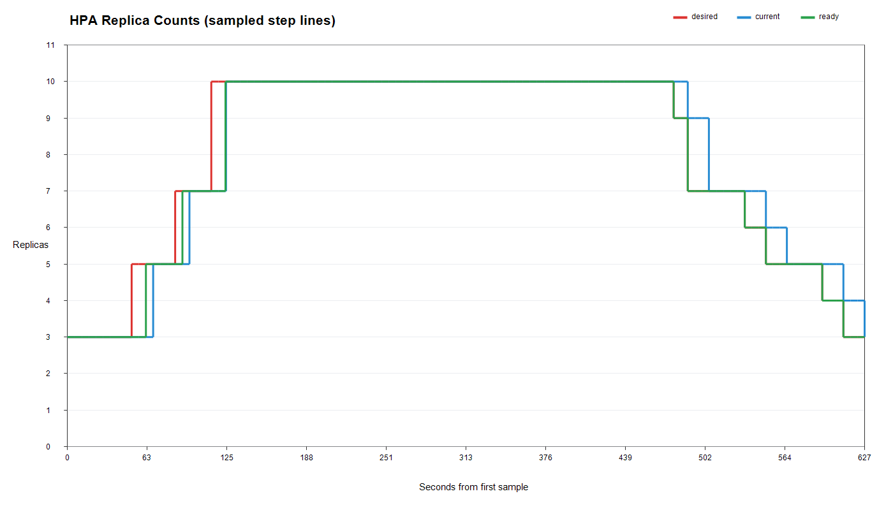
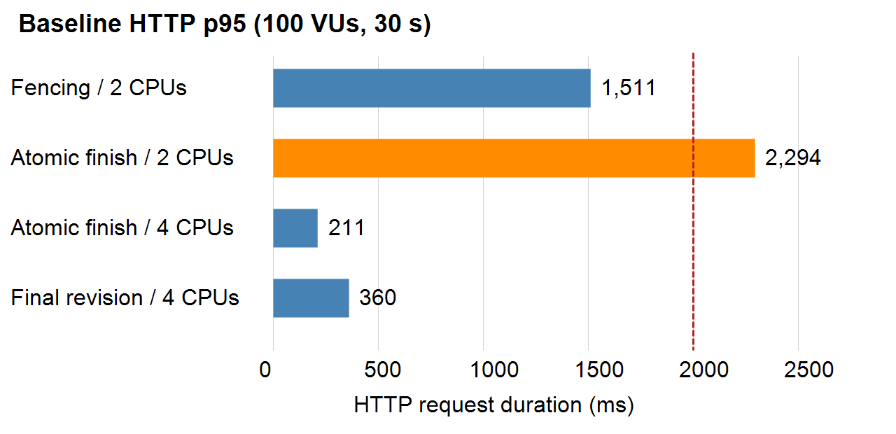

**Abstract—** SayangCare is a distributed voice-support prototype built with Rust/Actix Web, Redis Sentinel, PostgreSQL and optional OpenRaft. PostgreSQL commits versioned session checkpoints before acknowledgment; Redis provides a recoverable hot projection and risk/FIFO queue. Three fixed Raft voters coordinate volunteer ownership generations, while PostgreSQL rejects stale-owner mutations. The latest workspace run passed 115 tests (eight ignored); three database integration tests were also executed. A prior four-CPU Minikube evaluation passed 100-user baseline, API-pod-loss and HPA workloads; its 9,248-lifecycle HPA run had zero HTTP failures and p95 282 ms. After primary-aware pool validation, bounded same-ID creation retry and clean fast shutdown were added, a separate two-CPU cluster completed a 20-user PostgreSQL replacement workload: 2,216 lifecycles, zero HTTP failures, 7.16-second observed recovery, and no missing acknowledged operations. Three-node Raft tests exercised claim races, fencing, leader loss, quorum loss and rejoin. These are bounded synthetic experiments, not production or arbitrary-partition guarantees. The approved demonstration is dashboard-based; live telephony and clinical safety remain unvalidated.

**Keywords—** distributed systems, voice interface, session recovery, circuit breaker, Raft, telehealth triage

::: {.twocol}

## 1. Introduction and Motivation

Telephone access can lower interface barriers for people who find mobile applications difficult. Voice assistants and social robots have been studied for social support and loneliness [7], [8], but that evidence does not validate AI clinical care. SayangCare is a supportive-listening prototype, not diagnosis, treatment or an emergency service.

Calls span webhook requests and API instances and depend on telephony and inference providers. A process failure must not erase conversation state; slow inference must not block a caller indefinitely. Elevated-risk callers also need a human escalation path.

The project combines versioned checkpoints, a Redis hot projection, an inactivity sweeper, cached-audio fallback and auditable volunteer assignments. A Redis failover test motivated PostgreSQL-backed commit authority. The contribution is their integration, not a new consensus algorithm or validated triage model.

Synthetic fault tests measure state preservation and bounded fallback, not real-call safety or human outcomes.

## 2. Related Work

Circuit breakers stop calls to a failing dependency and admit a controlled recovery probe [1], [2]. SayangCare uses Closed, Open and Half-Open states, adjusting error and latency thresholds according to a caller distress signal. This connects degradation to session context; its heuristic and thresholds remain unvalidated.

Raft commits state-machine decisions by majority [3]. OpenRaft here coordinates ownership, not Redis queue ordering or Kubernetes pod replacement. Fencing requires the protected resource to reject stale owners [9]: each claim, transfer or release advances a retained generation that PostgreSQL validates. PostgreSQL transactions can provide the same fencing without Raft; our comparison concerns quorum behaviour and coordination cost, not Raft's uniqueness.

Redis Sentinel promotes a replica after master failure [4], but asynchronous replication is not durable commit authority. After observing acknowledged-session loss, SayangCare moved commits to synchronously replicated PostgreSQL and retained Redis as a best-effort projection. This protects tested operations, not cross-system linearizability or arbitrary partitions.

The voice-assistant studies evaluate human outcomes that SayangCare has not measured. This project instead evaluates state recovery and a human-review handoff; it claims neither the reported wellbeing benefits nor clinical risk-classifier validity.

## 3. System Design

SayangCare is structured as a modular monolith in a Rust Cargo workspace. The `core` crate defines domain models and service ports; infrastructure crates implement persistence, telephony, queueing, and circuit breaking; the Actix Web API composes the components and exposes HTTP endpoints. This keeps deployment to one API service while making the interfaces between major responsibilities explicit.

**Figure 1.** Request and state flow:

```text
Caller <-> Twilio <-> Actix API
                       |-- PostgreSQL: versioned commit authority (CAS)
                       |-- Redis Sentinel: best-effort hot projection
                       |-- Groq inference: distress-aware breaker
                       |      `-- cached audio / deterministic reply
                       |-- Redis: risk/FIFO waiting queue
                       |-- optional 3-node Raft: ownership generations
                       `-- PostgreSQL: fenced updates, archive and audit
```

### 3.1 Call and state lifecycle

Twilio sends form-encoded requests to `/twilio/voice`, `/twilio/gather`, and `/twilio/status`; SayangCare returns TwiML rather than JSON on these routes. An incoming `CallSid` becomes the stable session identifier, so webhook retries can resolve to the existing session instead of creating a new conversation. The `/gather` handler records the speech transcript, obtains a response, and returns another gather prompt. The status callback drives terminal archival. Separate JSON endpoints support the local Call Lab, session inspection, and volunteer operations.

Each active mutation commits a versioned PostgreSQL checkpoint before acknowledgment. SQL compare-and-swap (CAS) prevents stale transcript replacement; reads use checkpoint authority, not Redis. Projection failures are logged and bounded to 100 ms. The revised completion path locks the current checkpoint, transitions terminal state, archives the JSONB transcript and retires recovery state in one PostgreSQL transaction. This replaces three separate terminal commits with one without disabling WAL synchronization or replica acknowledgment. Failure rolls back the transaction; successful completion remains durable. Version-safe Redis cleanup follows commit. The sweeper recovers retained work every 30 seconds and abandons five-minute inactive calls. Legacy active Redis records can be adopted lazily. Redis is not periodically reconciled against every PostgreSQL session; missing or stale projections remain a documented operational limitation.

### 3.2 Inference degradation and risk handling

For non-crisis turns, the API can call a Groq-compatible chat-completion service. Inference calls pass through a sliding-window circuit breaker that records latency and failures, estimates the 95th-percentile latency, and uses Closed, Open, and Half-Open states. A single recovery probe is admitted during Half-Open. Request generations prevent stale completions from changing the state of a newer breaker generation. An adaptive policy scales the error and latency limits according to a normalized distress signal; when inference is unavailable, the service uses a deterministic text reply or a bundled holding-audio response.

Risk classification is a local, weighted phrase heuristic assigning levels 1–5. Levels 4–5 meet the immediate-escalation condition. A high-risk turn bypasses generative inference, receives a fixed safety-oriented response, and is queued for human review. Thus the model is not responsible for deciding whether to persist the session or whether to enqueue a high-risk turn. This reduces dependence on the inference provider for the escalation path, but a phrase matcher can miss paraphrases, context, negation, and multilingual speech. It must not be interpreted as a validated mental-health assessment.

### 3.3 Queue, assignments, and deployment

Redis sorts waiting cases by descending risk then FIFO in both evaluated configurations. Optional OpenRaft coordinates ownership through three fixed voters, requiring two for a new decision. An initial claim receives generation 1, transfer 2, release 3 and reclaim 4; release retains a tombstone so tokens cannot reset. Notes, transfer, release and resolve carry the displayed generation and a stable request ID. PostgreSQL locks the ownership row and rejects a mismatched token with HTTP 409, including A-to-B-to-A reuse of the same volunteer identity.

Raft and PostgreSQL are not one transaction. A durable PostgreSQL journal reserves each transition before consensus; protected writes are fenced while it is pending. Recovery retries the original immutable command and installs ownership, history and checkpoint atomically. A timeout is an unknown outcome, not proof of abortion. Redis projections are updated best-effort; complete periodic reconciliation is not implemented. Operator alerts are durable; the roster remains process-local.

Docker Compose supplies local dependencies; Kubernetes supplies API Deployment/Service, Redis/Sentinel StatefulSets, PVCs, HPA and NGINX Ingress. HPA reacts to CPU, memory and request-rate metrics [6]; it does not add physical capacity to a capped host. The evaluated single-node Minikube cluster uses three API replicas at rest, three Redis nodes, three Sentinels, and three CloudNativePG instances with synchronous replica acknowledgment. Prometheus, Adapter request-rate scaling and seven Grafana panels were verified locally. API pools have three database connections per process. Public DNS/TLS, live Twilio routing, node/zone failure and production deployment remain unvalidated.

## 4. Implementation

The seven-crate workspace separates API, domain, persistence, breaker, queue, telephony and Redis responsibilities. Actix Web supplies tracing, request IDs, the Call Lab and JSON routes. Twilio middleware reconstructs the public URL and verifies sorted form parameters with `X-Twilio-Signature` [5]; invalid signatures are rejected. REST call creation/update, callbacks, TwiML and signed outbound-connect routes have local contract tests, but no live-call validation.

The session-store crate uses SQLx migrations, including `0010_session_checkpoints.sql` and `0011_assignment_fencing.sql`, for durable snapshots, archives and ownership history. The shared PostgreSQL pool verifies that checked-out connections still reach a writable primary and replaces dead/demoted connections. Acquisition remains bounded to two seconds. Session creation alone retries transient failures for up to five seconds using the same stable call ID and `ON CONFLICT DO NOTHING`; ambiguous turns and other mutations are not blindly replayed. CNPG uses clean fast shutdown while preserving its 90-second stop budget, required synchronous replica acknowledgment and PostgreSQL durability settings. Redis retains projections with a one-hour TTL but is not the session authority. Archive failures retain checkpoints for retry. Terminal checkpoints and ownership journals currently have no automatic purge policy; stale projections are not covered by a complete periodic reconciliation process.

The circuit-breaker crate stores bounded samples in Redis, tracks error rate and p95 latency, trips after three consecutive failures and reserves one Half-Open probe across replicas. Scoring and reply generation have separate breakers. Sentiment adjusts degradation thresholds; deterministic local triage controls escalation. The risk heuristic is not clinically validated. Holding audio is a versioned local WAV asset.

The priority-queue crate adds an ownership-coordinator contract to its queue abstraction. OpenRaft supports leader forwarding, snapshots, retained generations and payload-aware request deduplication. Docker runs three fixed voters on ports 18081–18083; Kubernetes API replicas are not voters and use PostgreSQL-only ownership. Cases retain their authority: Raft-owned or pending cases never fall back during quorum loss, while legacy PostgreSQL-owned cases remain actionable. Dashboard cards display the authority. Archive-only cases restore a full PostgreSQL snapshot transactionally before ownership changes, after validating retained owner and generation; transfers, releases and resolves preserve audit history.

The team attempted Twilio integration using a US trial number. Local-access and trial constraints led to the professor-approved dashboard demonstration of synthetic callers and volunteer actions, not a live telephony evaluation. This is the team's experience, not a claim that every trial provides only US numbers; Twilio documents trial recipient and geographic restrictions [10]. GPT-OSS uses low reasoning effort and JSON sentiment output. A custom Prometheus-client exporter (not `actix-web-prom`) provides route/method/status counters and duration histograms, plus session, archive, pool and breaker metrics. Prometheus scraping, request-rate HPA and seven provisioned Grafana panels were verified locally.

## 5. Evaluation

### 5.1 Method and test boundaries

The latest recorded `cargo test --workspace --locked` run passed 115 tests, with eight environment-dependent tests ignored and no failures. Three session-store database integrations were also executed explicitly. These include stale/dead PostgreSQL connection replacement, bounded session-creation retry, retry exhaustion, checkpoint durability and fencing. A real failure/rejoin process test observed Raft leader change; a later Raft harness completed 411 assertions, but did not inject its optional Docker faults or run its PostgreSQL comparison. Thus Raft process-fault observations and the assertion harness are separate evidence, not one all-inclusive test.

The Kubernetes workload suite used synthetic incoming/turn/hangup workflows and audited acknowledged IDs against PostgreSQL transcripts, archives and checkpoints. Its unchanged acceptance gates require lifecycle success above 99%, zero failed lifecycle/check steps, read-back consistency above 99%, HTTP failures below 1% and HTTP p95 below 2,000 ms. Native exit 99 indicates failure even if acknowledged state survives. The later PostgreSQL report was generated after the recovery fix on a separate, two-CPU, 8-GiB Minikube cluster with inference disabled. It is not a controlled comparison with the earlier four-CPU Kubernetes/HPA runs.

The four-CPU host advertised 16 CPUs to Kubernetes while Docker had capped it at two; its actual quota was raised to four without deleting volumes. The earlier evaluation retained a three-connection API pool, two-second acquisition timeout, PostgreSQL synchronous replica acknowledgment, `fsync` and full-page writes. Its projected maximum of `(20 + 1 + 1) x 3 + 16 = 82` connections remained below the database limit of 100. In the later pool recovery fix, these pool bounds remained unchanged.

### 5.2 Kubernetes baseline, failover and autoscaling

**Table 1.** Synthetic results on the previously evaluated four-CPU image. “Attempts” counts k6 iterations; latency is HTTP p95/p99 in milliseconds. These runs precede the later PostgreSQL-pool and Raft compatibility commits.

| Test (VUs/duration) | Lifecycles | p95/p99 | HTTP failures | Result |
| --- | ---: | ---: | ---: | --- |
| Baseline (100/30 s) | 2,100 | 360/830 | 0% | pass |
| API pod loss (100/60 s) | 4,410 | 326/651 | 0% | pass; Ready 8.903 s |
| Redis master pause/promotion (20/120 s) | 2,208 | 112/123 | 0% | pass; recovery 8.157 s |
| HPA sustained load (100/120 s) | 9,248 | 282/507 | 0% | pass; 3 to 10 to 3 replicas |

For HPA, desired scale-up began after 50.5 s, an additional pod became Ready after 61.7 s, and scale-down returned to three replicas 502.6 s after load. Independent SQL and exact-ID audits matched all 9,248 acknowledged creates, turns and hangups to valid archives/checkpoints with no pending work or version mismatch. This validates the measured two-minute workload, not indefinite capacity or the subsequent code revision.

{width=3.25in}

{width=3.25in}

The original Redis-first fault lost 17 acknowledged creations and motivated PostgreSQL commit authority. On two CPUs, a durable-session sustained test later reached p95 2,220.53 ms with pool timeouts. Wait samples indicated WAL synchronization, while cgroup counters showed CPU throttling. The implementation then combined terminal transition, archive and checkpoint retirement into one transaction, increased actual four-CPU host capacity, and raised Actix keep-alive above the 60-second ingress upstream timeout. The last change addressed a recorded upstream 502 and has a six-second connection-reuse regression. As these were sequential interventions, the performance gain cannot be attributed to one code change alone. Earlier failed experiments are retained, not relabelled.

### 5.3 PostgreSQL recovery, Raft and inference

An earlier primary-replacement run on the previous image had 0.609% HTTP failures and 18.662-second recovery. After pool/shutdown changes, three successive tests show the retry process and final strict-gate result:

| PostgreSQL run (20 VUs/120 s) | HTTP failures | Recovery | Native exit | Acknowledged creates/turns/hangups |
| --- | ---: | ---: | ---: | ---: |
| First follow-up | 0.157% | 50.951 s | 99 | 2,228/2,227/2,227 |
| Second follow-up | 0.228% | 6.104 s | 99 | 2,191/2,191/2,191 |
| Final recorded follow-up | 0% | 7.160 s | 0 | 2,216/2,216/2,216 |

The passing run also recorded HTTP p95/p99 of 23.11/85.90 ms and SQL/archive consistency for acknowledged operations. It followed primary-aware writable-connection validation, clean fast CNPG shutdown, and up to five seconds of retry for idempotent session creation with the same Call SID. The synchronous replica requirement and two-second pool-acquisition bound were preserved. Other mutations are not blindly replayed. Two preceding failures remain evidence. The pass demonstrates one bounded primary replacement, not arbitrary outages, machine loss or a zero-error service-level guarantee.

Raft evidence is separate from Kubernetes HPA: three fixed processes demonstrated one winner in a concurrent claim, monotonically increasing claim/transfer/release/reclaim generations, HTTP 409 for stale owners, and HTTP 200 for the current generation. A real leader stop elected a new leader in a higher term and allowed a transfer; loss of quorum returned HTTP 503; rejoining nodes converged at applied index 41. The subsequent ownership harness passed 411 assertions for its executed scenarios, including compatibility and archive-only recovery, but skipped optional container fault injection and its PostgreSQL comparison. A three-sample-per-operation latency smoke is insufficient to claim Raft is faster or necessary; PostgreSQL-only mode enforces fencing too. No dynamic membership or Raft voters inside HPA pods are claimed.

Previously recorded inference evidence comprises ten real Groq sentiment/reply pairs without audio fallback (median caller-turn latency 1.13 s) and 34 mock failure/recovery lifecycles. These are bounded historical samples, not high-concurrency AI tests. Live Twilio calls were excluded by the professor-approved dashboard demonstration scope.

## 6. Discussion and Limitations

The principal reliability choice is versioned durable state rather than process-owned context or asynchronous Redis alone. PostgreSQL checkpointing removed the observed acknowledged-session loss in repeated Redis faults but increased database dependence. Primary-aware pool recovery and idempotent creation retries reduced failures in the tested PostgreSQL replacement scenario without relaxing synchronous durability. Database outages outside the bounded retry window still fail explicitly, and an ambiguous create response should be retried with the same call ID. The HPA/baseline results predate later code; they do not establish that the exact latest combined revision meets sustained-load gates. Neither this design nor the experiments establish cross-system linearizability or arbitrary-partition safety.

The modular monolith reduces orchestration cost while sharing distributed dependencies. The roster is process-local; alerts are durable and shared. Completed checkpoints, assignment journals and tombstones have no automatic retention policy. Redis projection cleanup is version-guarded, but comprehensive periodic projection reconciliation and safe retention cleanup remain future work; Redis counts are not authoritative session counts. Production also needs privacy/retention policy, least-privilege secrets, network policies, TLS and restoration tests. A single Kubernetes node cannot establish node/zone availability. Although the latest bounded PostgreSQL replacement run passed, these results do not prove error-free availability under arbitrary failures.

Keyword risk scoring is not a substitute for a trained and independently evaluated risk model or a human crisis service. Synthetic sessions and deterministic test responses do not demonstrate safe real-caller outcomes. Any pilot would need a documented escalation protocol, consent and data-retention policy, privacy review for sensitive transcript storage, accessibility testing, and clear user messaging about the service's non-clinical scope. The current report therefore makes no claim that SayangCare is ready to handle real mental-health emergencies.

## 7. Conclusion and Future Work

SayangCare integrates signed voice-webhook contracts, durable versioned checkpoints, adaptive inference degradation and generation-fenced volunteer handoff. Redis orders the queue; PostgreSQL preserves durable state and rejects stale owners; optional three-node Raft coordinates ownership through a majority without being embedded in autoscaled API pods. The measured baseline, API-loss, Redis-promotion and HPA runs passed on the earlier evaluated image. A separate later primary-replacement run passed strict gates after targeted recovery changes. The evidence supports a tested prototype, not production capacity, live telephony reliability or multi-node availability.

Dashboard simulation is the approved demonstration scope; it does not validate speech recognition, carrier audio, public callbacks or outbound ringing. With funding, a future pilot could obtain a voice-capable Singapore Twilio number, subject to availability and number-specific regulatory eligibility, and validate both call directions. Singapore domestic outbound guidance requires a Twilio Singapore caller ID [11]; national numbers require business documentation and Level-6 numbers a Singapore business address [12]. Payment alone does not ensure eligibility. Next work includes exact post-fix baseline/API-loss/HPA regression, checkpoint/journal retention, projection reconciliation, multi-node and backup-restoration testing. Ambiguous telephony recovery still needs operator review: no transactional dispatch outbox exists. Synthetic success does not establish emergency-service readiness.

## References

[1] M. Fowler, “CircuitBreaker,” _martinfowler.com_, 2014. [Online]. Available: https://martinfowler.com/bliki/CircuitBreaker.html

[2] M. T. Nygard, _Release It!: Design and Deploy Production-Ready Software_, 2nd ed. Raleigh, NC, USA: Pragmatic Bookshelf, 2018.

[3] D. Ongaro and J. Ousterhout, “In search of an understandable consensus algorithm,” in _Proc. USENIX Annual Technical Conference (USENIX ATC ’14)_, 2014, pp. 305–319. [Online]. Available: https://www.usenix.org/conference/atc14/technical-sessions/presentation/ongaro

[4] Redis Ltd., “High availability with Redis Sentinel.” [Online]. Available: https://redis.io/docs/latest/operate/oss_and_stack/management/sentinel/

[5] Twilio, “Security: Validating requests.” [Online]. Available: https://www.twilio.com/docs/usage/security#validating-requests

[6] Kubernetes Authors, “Horizontal Pod Autoscaling.” [Online]. Available: https://kubernetes.io/docs/tasks/run-application/horizontal-pod-autoscale/

[7] V. K. Jones, C. Yan, M. Y. Shade, et al., “Reducing loneliness and improving social support among older adults through different modalities of personal voice assistants,” _Geriatrics_, vol. 9, no. 2, p. 22, 2024, doi: 10.3390/geriatrics9020022.

[8] Y. Yang, C. Wang, X. Xiang, and R. An, “AI applications to reduce loneliness among older adults: A systematic review of effectiveness and technologies,” _Healthcare_, vol. 13, no. 5, p. 446, 2025, doi: 10.3390/healthcare13050446.

[9] M. Kleppmann, “How to do distributed locking,” 2016. [Online]. Available: https://martin.kleppmann.com/2016/02/08/how-to-do-distributed-locking.html

[10] Twilio, “Get started with your Twilio free trial account.” [Online]. Available: https://www.twilio.com/docs/usage/tutorials/how-to-use-your-free-trial-account. Accessed: Nov. 16, 2026.

[11] Twilio, “Singapore: Voice guidelines.” [Online]. Available: https://www.twilio.com/en-us/guidelines/sg/voice. Accessed: Nov. 16, 2026.

[12] Twilio, “Singapore: Regulatory guidelines.” [Online]. Available: https://www.twilio.com/en-us/guidelines/sg/regulatory. Accessed: Nov. 16, 2026.

:::
